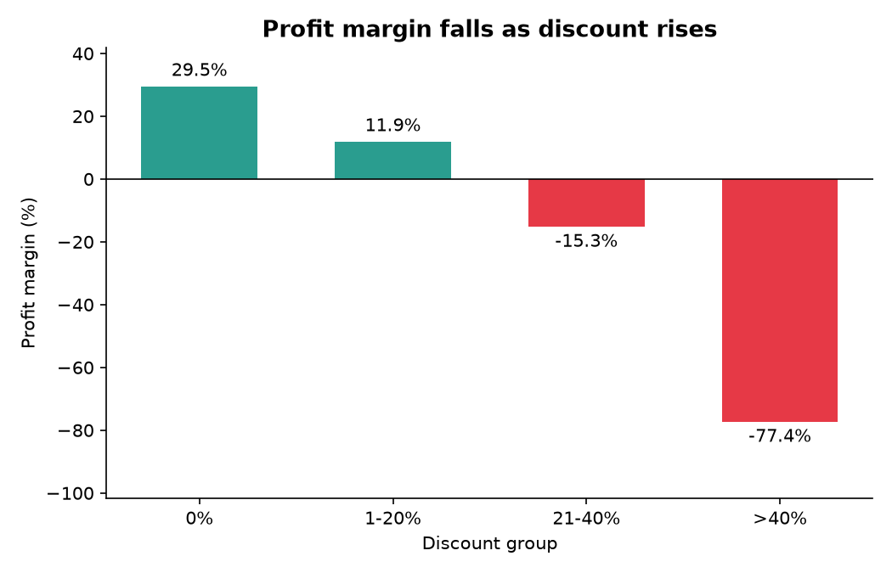
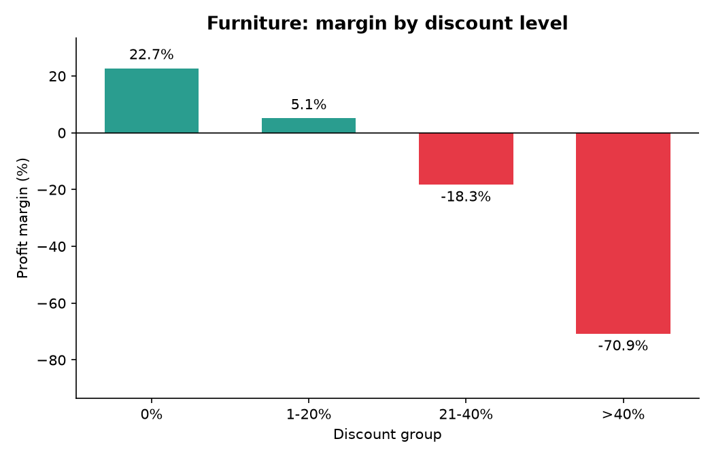
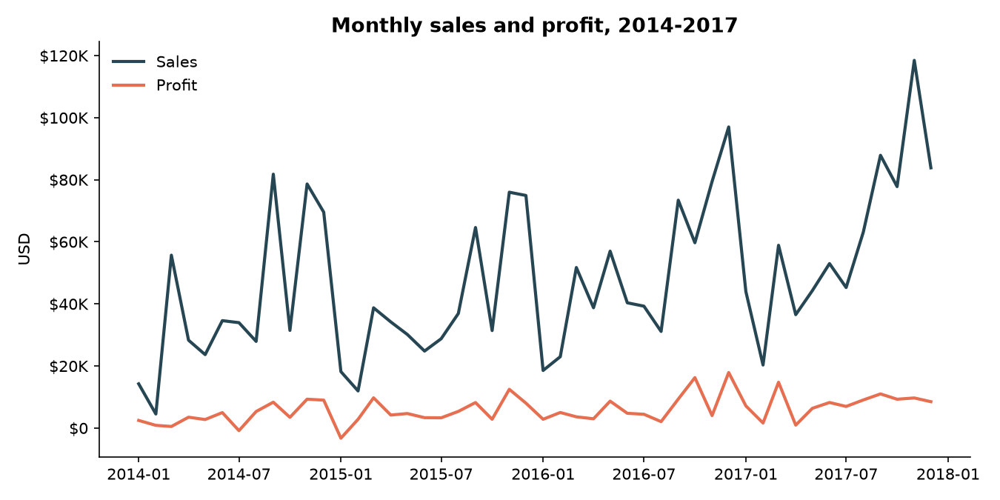

# Superstore Sales Analytics

> **Summary (English):** This project analyzes four years of sales data from a retail store (the public Superstore dataset, 9,994 transactions) to find out which products and regions really make a profit, not only revenue. The main finding is that transactions with large discounts have much lower margins: above 40% discount, the margin is about -77%. Furniture sells about as much as Office Supplies, but its margin is only 2.5%, and this low margin is concentrated in transactions with discounts above 20%. I used Python (pandas) and SQL (SQLite), and I checked every key number twice.

Analisis performa penjualan retail: tren omzet, profitabilitas produk, dan dampak diskon terhadap profit. Dikerjakan dengan **Python (pandas, matplotlib)** dan **SQL (SQLite)**.

## Latar Belakang

Sebuah toko retail ingin tahu produk, kategori, dan wilayah mana yang benar-benar menghasilkan profit, bukan hanya omzet. Proyek ini mensimulasikan pekerjaan analis penjualan: membersihkan data, mengeksplorasi pola, lalu menerjemahkannya menjadi rekomendasi bisnis.

## Pertanyaan Bisnis

1. Bagaimana tren omzet dan profit per tahun dan per bulan? Kapan musim puncaknya?
2. Kategori dan sub-kategori apa yang paling untung, dan mana yang merugi?
3. Wilayah mana yang performanya paling baik dan paling lemah?
4. Apakah transaksi dengan diskon besar menghasilkan profit yang lebih rendah?
5. Berapa persen produk yang menyumbang 80% omzet (Pareto)?

## Dataset

- **Sumber:** [Superstore Dataset (Kaggle)](https://www.kaggle.com/datasets/vivek468/superstore-dataset-final)
- **Ukuran:** 9.994 transaksi, 21 kolom
- **Periode:** Januari 2014 sampai Desember 2017
- **Satuan:** dolar AS ($)

File dataset tidak disertakan di repo ini. Unduh sendiri dari link di atas dan simpan dengan nama `Sample - Superstore.csv` di folder yang sama dengan script.

## Tools

Python (pandas, matplotlib), SQL (SQLite, window function, CTE), Git/GitHub.

## Struktur Repo

```
├── 01_cleaning.py         # cleaning data + pembuatan kolom tambahan
├── 02_analysis.py         # analisis awal: tahun, kategori, region, diskon, Pareto
├── 03_diskon_check.py     # uji lanjutan: apakah diskon menjelaskan profit rendah?
├── 04_load_to_sqlite.py   # memuat data bersih ke database SQLite
├── 05_run_sql.py          # menjalankan seluruh query di analysis.sql
├── 06_charts.py           # membuat 3 grafik untuk README
├── analysis.sql           # 5 query analisis (LAG, RANK, CTE, cumulative sum)
└── images/                # grafik hasil 06_charts.py
```

## Cara Menjalankan

```bash
pip install pandas matplotlib
python 01_cleaning.py
python 02_analysis.py
python 03_diskon_check.py
python 04_load_to_sqlite.py
python 05_run_sql.py
python 06_charts.py
```

## Proses Singkat

**Cleaning (`01_cleaning.py`)**
- Data tidak memiliki missing value maupun duplikat.
- Kolom `Order Date` dan `Ship Date` diubah dari teks ke tipe tanggal.
- `Postal Code` diubah ke teks 5 digit agar angka nol di depan tidak hilang.
- Kolom tambahan: `Year`, `Month`, `YearMonth`, `Ship Days`, `Profit Margin %`, `Is Loss`, dan `Discount Group` (0%, 1-20%, 21-40%, >40%).
- Nilai ekstrem pada `Profit` sengaja **tidak dihapus**, karena merupakan transaksi nyata yang justru relevan untuk analisis.
- Data bersih disimpan sebagai `superstore_clean.csv` (tidak ikut di repo).

**Analisis (Python dan SQL)**
Semua angka utama dihitung dua kali, dengan pandas dan dengan SQL, lalu dicocokkan untuk memastikan hasilnya konsisten.

## Temuan Utama

**Gambaran umum:** total omzet sekitar **$2,30 juta** dan profit sekitar **$286 ribu** (margin 12,5%) selama 2014-2017.

### 1. Transaksi berdiskon besar punya margin jauh lebih rendah

| Kelompok diskon | Transaksi | Margin |
|---|---|---|
| 0% | 4.798 | 29,5% |
| 1-20% | 3.803 | 11,9% |
| 21-40% | 460 | -15,3% |
| >40% | 933 | -77,4% |



Dua kelompok diskon teratas menghasilkan kerugian gabungan sekitar **$135 ribu**, hampir setengah dari total profit seluruh toko.

### 2. Furniture: margin rendah terkonsentrasi di transaksi berdiskon besar

Furniture beromzet $742 ribu (hampir sama dengan Office Supplies) tetapi marginnya hanya **2,5%**, versus sekitar 17% untuk dua kategori lain. Saat dipecah per level diskon, polanya jelas:

| Diskon | Margin Furniture |
|---|---|
| 0% | 23% |
| 1-20% | 5% |
| 21-40% | -18% |
| >40% | -71% |



Transaksi Furniture dengan diskon di atas 20% merugi sekitar **$54 ribu**, sementara total profit Furniture hanya $18 ribu.

### 3. Sub-kategori yang merugi

**Tables** (-$17,7 ribu), **Bookcases** (-$3,5 ribu), dan **Supplies** (-$1,2 ribu). Tables dan Bookcases punya rata-rata diskon tinggi (26% dan 21%). **Supplies adalah pengecualian**: diskonnya hanya 7,7%, jadi penyebabnya kemungkinan harga jual atau biaya produk. **Machines** juga patut diperhatikan (omzet $189 ribu, margin 1,8%, diskon rata-rata 31%).

### 4. Region Central paling lemah

| Region | Rata-rata diskon | Profit | Transaksi rugi |
|---|---|---|---|
| Central | 24,0% | $39,7 ribu | 31,9% |
| South | 14,7% | $46,7 ribu | 16,0% |
| East | 14,5% | $91,5 ribu | 19,4% |
| West | 10,9% | $108,4 ribu | 9,9% |

Central beromzet lebih besar dari South tetapi profitnya lebih kecil, dengan diskon tertinggi dan proporsi transaksi rugi tertinggi.

### 5. Pola musiman dan pertumbuhan



- Omzet tinggi di **September, November, dan Desember** (rata-rata sekitar $77 ribu, $88 ribu, dan $81 ribu per bulan, dibanding rata-rata bulanan keseluruhan sekitar $48 ribu), dan paling rendah di **Januari dan Februari** (sekitar $24 ribu dan $15 ribu).
- Omzet tumbuh 29,5% (2016) dan 20,4% (2017), tetapi margin turun dari 13,4% ke 12,7% pada 2017. Rata-rata diskon stabil di kisaran 15,5-15,8% setiap tahun, jadi penurunan ini tidak tampak dijelaskan oleh rata-rata diskon dan masih menjadi pertanyaan terbuka.
- Bulan dengan omzet tinggi belum tentu paling menguntungkan. Contoh: November 2016 beromzet $79 ribu dengan profit hanya $4 ribu (margin sekitar 5%).

### 6. Pareto

**420 dari 1.850 nama produk unik (22,7%)** menyumbang 80% omzet. Jika dihitung per Product ID, hasilnya 414 dari 1.862 (22,2%).

## Rekomendasi

1. **Batasi diskon Furniture maksimal 20%.** Di atas itu, margin rata-rata Furniture negatif (-18% untuk diskon 21-40% dan -71% untuk diskon di atas 40%).
2. **Terapkan batas diskon per kategori**, bukan satu angka untuk semua. Binders punya diskon rata-rata 37% tetapi tetap untung 14,9%, jadi toleransi tiap kategori berbeda.
3. **Evaluasi harga dan promo Tables dan Bookcases**, misalnya hentikan promo besar atau naikkan harga.
4. **Audit kebijakan diskon di region Central** dan bandingkan dengan praktik di West.
5. **Selidiki Supplies dan Machines dari sisi harga dan biaya**, bukan diskon.
6. **Prioritaskan stok dan promosi untuk ~23% produk** yang menyumbang 80% omzet.
7. **Siapkan stok dan kapasitas untuk September, November, dan Desember**, tetapi pantau margin pada bulan promo agar omzet tinggi tidak dibayar dengan profit rendah.

## Keterbatasan

- Hubungan diskon dan profit di sini adalah **korelasi**, bukan bukti sebab-akibat. Analisis Furniture lebih kuat karena sudah mengendalikan kategori, tetapi belum mengendalikan faktor lain.
- Estimasi profit jika diskon dibatasi tidak memperhitungkan kemungkinan sebagian penjualan tidak akan terjadi tanpa diskon.
- Dataset tidak memuat biaya produk atau harga pokok, sehingga penyebab margin rendah pada Supplies dan Machines belum bisa dipastikan.
- Dataset bersifat sampel dan tidak mewakili toko tertentu di dunia nyata.

## Pembuat

**Agnes Putri Istiwana**
[GitHub](https://github.com/agnesputrii16) | [LinkedIn](https://linkedin.com/in/agnesputrii16)

Project lain: [KitchenHub A/B Test & Funnel Analytics](https://github.com/agnesputrii16/kitchenhub-ab-test-analytics) | [Ordivo SaaS Analytics](https://github.com/agnesputrii16/ordivo-saas-analytics)